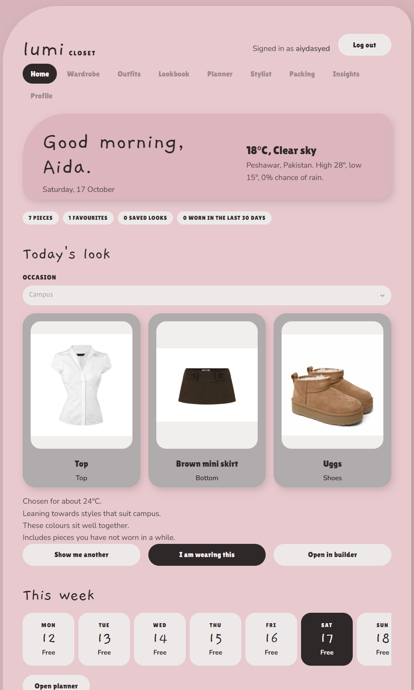
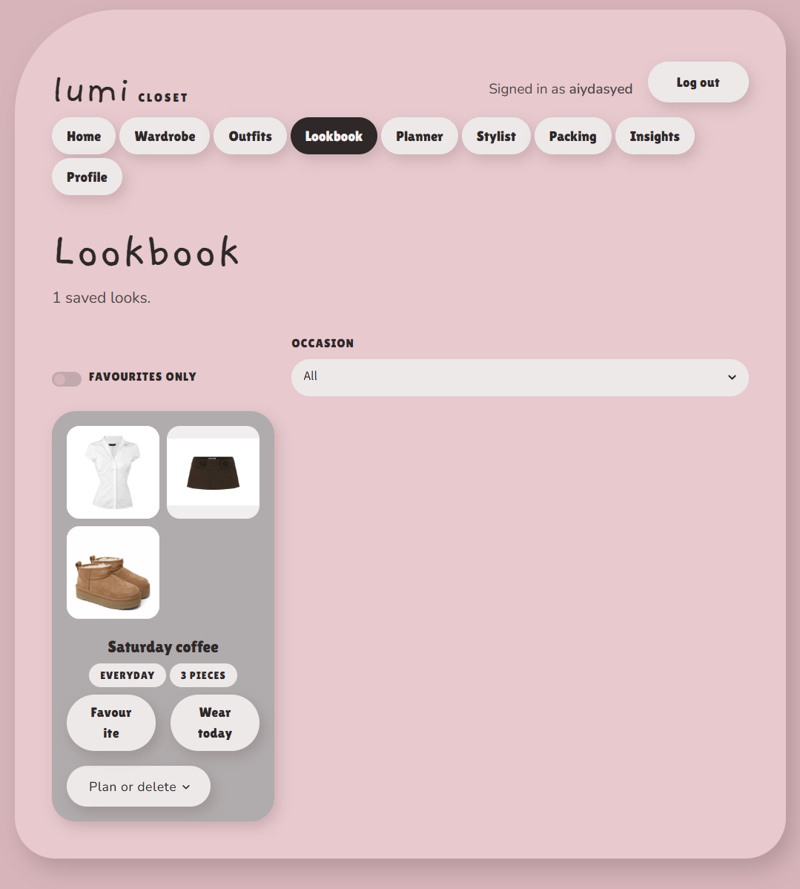
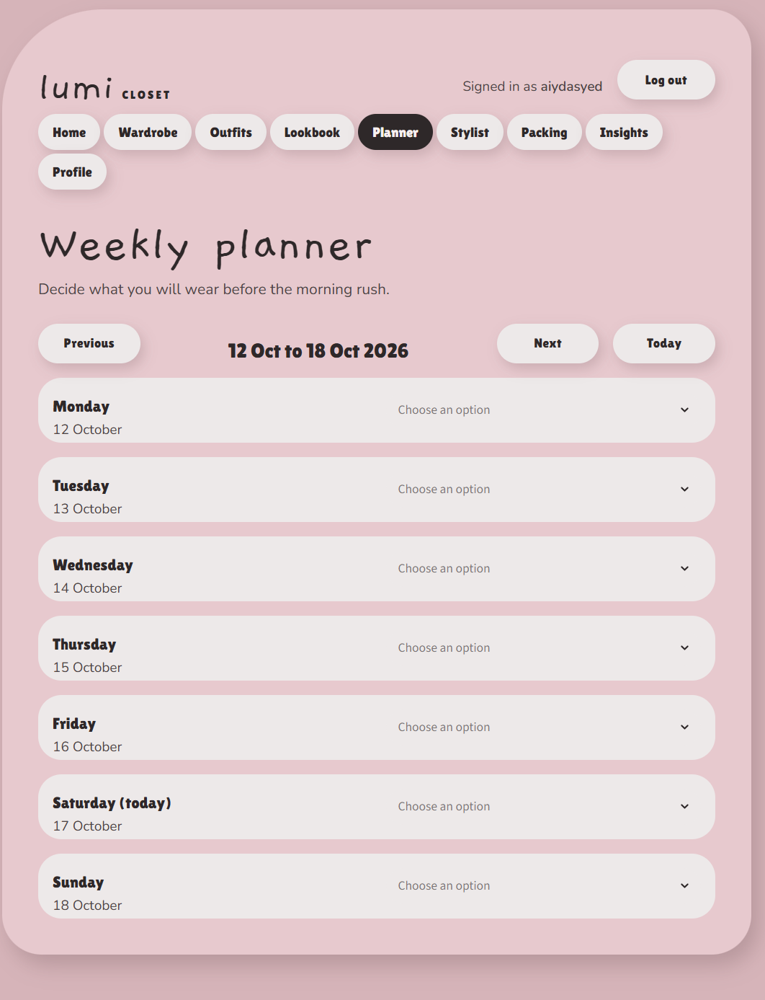
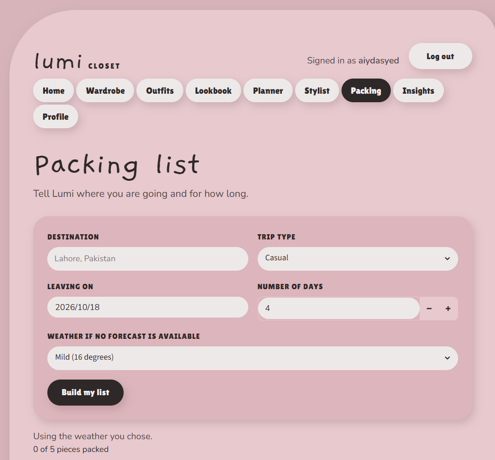
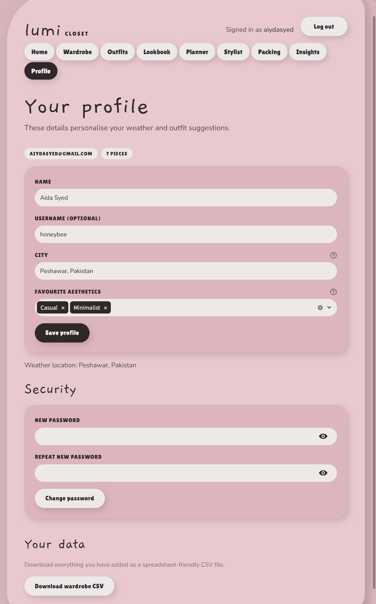

# Lumi Closet ✨
### Your Personal AI-Powered Wardrobe & Styling Assistant

Lumi Closet is an interactive wardrobe management and personal styling application built with **Python and Streamlit**. It helps users organize their clothing, create outfit combinations, plan daily looks, and explore their personal style with intelligent recommendations.

Designed with a modern, aesthetic interface, Lumi Closet combines wardrobe organization, outfit planning, weather-based suggestions, and AI-powered styling features in one place.

## Features

- **Digital Wardrobe:** Organize and manage clothing items in a digital closet.
- **Outfit Builder:** Create outfit combinations from your wardrobe.
- **AI Stylist:** Get personalized styling assistance and outfit suggestions.
- **Lookbook:** Save and revisit favorite looks.
- **Outfit Planner:** Plan outfits ahead of time.
- **Packing Assistant:** Organize clothing and outfits for trips.
- **Wardrobe Insights:** Explore clothing usage and wardrobe statistics.
- **Weather-Based Recommendations:** Consider weather conditions when choosing outfits.
- **Wear Tracking:** Track clothing usage over time.
- **Personalized Profiles:** Manage personal information and style preferences.
- **Data Export:** Export supported wardrobe data.

## Screenshots

### Dashboard


### Digital Wardrobe


### Outfit Builder


### Lookbook


### Outfit Planner


### AI Stylist


### Packing Assistant


### Wardrobe Insights


### User Profile


## Tech Stack

| Technology | Purpose |
|---|---|
| Python | Core application logic |
| Streamlit | Interactive web interface |
| Pandas | Data processing and analysis |
| Supabase | Authentication, database, and storage |
| Open-Meteo | Weather data |
| OpenAI / Gemini | Optional AI-powered features |
| Git & GitHub | Version control |

## Getting Started

### Prerequisites

- Python 3.11 or another version supported by the project's dependencies
- A Supabase project
- API credentials for optional AI features

### Installation

**1. Clone the repository**

```bash
git clone https://github.com/aida214/Lumi-AI-Closet.git
cd Lumi-AI-Closet
```

**2. Create a virtual environment**

Windows PowerShell:

```powershell
python -m venv .venv
.venv\Scripts\Activate.ps1
```

**3. Install dependencies**

```bash
python -m pip install -r requirements.txt
```

**4. Configure environment secrets**

Create `.streamlit/secrets.toml` and add your own Supabase credentials:

```toml
SUPABASE_URL = "YOUR_SUPABASE_URL"
SUPABASE_ANON_KEY = "YOUR_SUPABASE_ANON_KEY"
```

Add any optional AI provider credentials required by your configuration.

**Never upload real credentials, API keys, or your `secrets.toml` file to GitHub.**

**5. Set up the database**

Review and run `schema.sql` in your Supabase SQL Editor to configure the required database tables and policies. If the database already contains data, review the SQL before executing it.

**6. Launch the application**

```bash
python -m streamlit run app.py
```

Open the local URL displayed in the terminal, usually `http://localhost:8501`.

## Project Structure

```text
Lumi-AI-Closet/
├── app.py
├── app_pages/
├── components/
├── database/
├── utils/
├── assets/
├── screenshots/
│   ├── dashboard.png
│   ├── wardrobe.png
│   ├── outfitt.png
│   ├── lookbook.png
│   ├── planner.png
│   ├── stylist.png
│   ├── packing.png
│   ├── insight.png
│   └── profile.png
├── tests/
├── docs/
├── schema.sql
├── requirements.txt
├── requirements-dev.txt
├── .gitignore
├── Dockerfile
└── README.md
```

## Security

- Keep API keys and credentials private.
- Use Supabase Row Level Security to protect user data.
- Validate user inputs and uploaded files.
- Review storage permissions and database access policies.
- Never commit `.streamlit/secrets.toml` or other files containing secrets.

## Future Improvements

- More advanced personalized outfit recommendations.
- Enhanced wardrobe analytics and visualizations.
- Improved outfit search and filtering.
- More intelligent packing suggestions.
- Expanded automated testing and deployment options.

## About the Project

Lumi Closet is a portfolio project exploring the intersection of **data science, AI, personalization, and full-stack application development**. It brings together data processing, interactive interfaces, database integration, and optional AI services to create a practical personal styling experience.

---

**Built with Python, Streamlit, and a love for personal style.**
