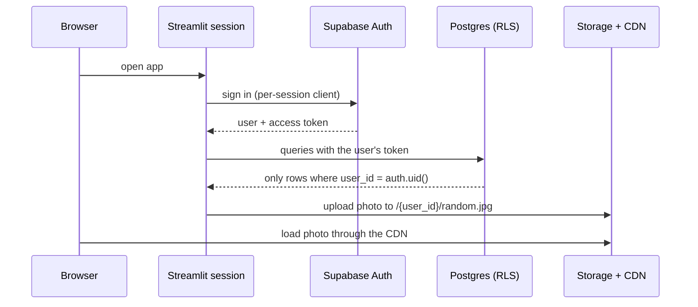

# Architecture

## Shape of the system

Lumi Closet is a single Streamlit process talking to Supabase. There is no custom backend server: the app
code calls Supabase over HTTPS with the signed-in user's token, and the database enforces who can see what.

## Layers

1. Pages (`app_pages/`) and components: layout and user interaction only.
2. Repository (`database/repository.py`): every query and storage call in one place.
3. Logic (`utils/`): outfit engine, colour rules, insights, weather, image prep. Plain Python, no Streamlit, which is why
   it is easy to test.
4. Supabase: Postgres, Auth and Storage. Row Level Security is the real permission boundary.

## Decisions and trade-offs

| Topic | Decision | Why |
| --- | --- | --- |
| Auth state | One Supabase client per browser session, stored in `st.session_state` | A shared client holds one user's token. With `st.cache_resource` a second visitor logging in would change what the first visitor can read. |
| Permissions | Row Level Security on every table; storage policies tie uploads to a folder named after the user | The database refuses cross-user access even if application code has a bug. |
| Outfit logic | Transparent scoring rules, not a model | Explainable ("added a layer because it is 14 degrees and 70% rain"), testable, no training data needed. |
| AI | Optional and degrading: Gemini tags photos, OpenAI answers chat; without keys the app still works | Costs and outages never block the core product. Models are configurable because they get retired. |
| Caching | Weather and geocoding in a process-wide TTL cache (30 minutes, 24 hours, 2 minutes after a failure). Photos carry a one-year cache header. | Weather does not change per rerun, and photo URLs are immutable because names are random. Database reads are not cached so changes show immediately. |
| CDN | Public Supabase Storage bucket, served through Supabase's CDN | Photos are static assets. Random names stop guessing, but the bucket is public by design. |
| Rate limiting | Sliding-window limiter per session for login attempts, photo tagging, chat and uploads | Protects API spend and slows accidental floods. Streamlit has no request layer, so this is not a per-IP defence. |
| Errors | Each page runs inside an error boundary; actions use `run_action` and report friendly toasts; details go to logs and Sentry | Users see plain messages, developers see stack traces. |
| Logging | One line per event on stdout, level from `LOG_LEVEL` | Works on any host without extra agents. |
| Monitoring | `/_stcore/health` plus Docker `HEALTHCHECK`, Sentry for exceptions, Supabase dashboard for the database | Enough to know whether the app is up and what is failing. Point an uptime monitor at the health URL. |

## Scaling notes

- The app process is stateless apart from each user's Streamlit session, which lives in server memory.
  More replicas need session affinity because Streamlit keeps a WebSocket per session.
- Postgres is managed by Supabase. Indexes exist for the access patterns the pages use
  (`user_id` plus `created_at`, wear log by user and date, chat by user and time).
- Lists are paginated in the UI (12 pieces at a time). Photos are capped at 1200 pixels on the long side
  and compressed before upload, which keeps bandwidth and storage low.
- The first things to change at larger scale: move the in-memory weather cache to Redis, add server-side
  pagination to `list_items`, and put a gateway in front for per-IP limits.

## Data model

`profiles` (one per auth user) owns `wardrobe`, `wear_log`, `saved_outfits`, `planner` and `chat_history`.
`outfit_items` links outfits to wardrobe pieces. `planner` has a unique index on `(user_id, date)` so a day
holds one look, and `wear_log` is unique on `(wardrobe_item_id, worn_on)` so a piece is logged once a day.
A trigger on `auth.users` creates the profile row at sign-up.
